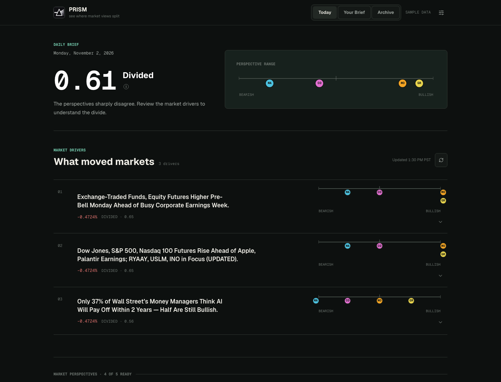

# Prism

> See where market views split.

Prism is a daily market app that shows where deliberately biased perspectives
agree and disagree on the same evidence. It stacks two layers on the same facts:

1. **The neutral base layer** — a flat, source-attributed account of what moved
   markets on the previous trading day.
2. **The perspective layer** — a fixed cast of five investor archetypes, each a
   distinct and deliberately *biased* view, reacting to that base layer in
   character.

Prism calculates a deterministic **disagreement score** for each brief and
market driver so readers can quickly find where the perspectives split.

## Preview

[Open the public demo](https://mushtidig.github.io/prism/) — a read-only build
using bundled sample data.



See [`SPEC.md`](./SPEC.md) for the functional spec and
[`docs/superpowers/specs/`](./docs/superpowers/specs/) for the implementation
design.

## Architecture

A TypeScript monorepo (npm workspaces):

```
shared/   Types shared by server + web (the DayContent contract)
server/   Express API · generation pipeline · daily cache · sample/time-machine data
web/      React + Vite SPA (Uber-style monochrome UI)
```

The frontend only ever calls the Prism API and renders the `DayContent` it gets
back — API keys stay server-side, and all users see identical daily content.

**Daily content flow:** a request for a trading day serves a dated JSON cache if
present; on a miss it runs the pipeline once (market data → neutral briefing →
5 persona POVs in parallel → deterministic divergence math), caches the result,
and serves it. Persona failures leave retryable unavailable lenses on the live
briefing; failures that prevent the briefing itself use the bundled sample day.

- **Market data:** Alpha Vantage (US equities).
- **LLM:** OpenRouter via the OpenAI SDK, defaulting to
  `nvidia/nemotron-3-super-120b-a12b:free`, with `openrouter/free` as the
  recommended fallback. Model-agnostic by design.
- **Divergence:** computed deterministically from each persona's structured
  −2..+2 conviction stances — no LLM judge.
- **Guardrails:** neutral-tone enforcement on the briefing, ≤200-word + plain
  English + no-advice checks on every POV, and grounding (every stance must
  reference a real key point). Each stage retries once, then falls back.

## Running

Node.js 22.5 or newer is required because the evaluation ledger uses the
built-in `node:sqlite` module.

```bash
npm install

# Sample mode (no keys needed) — opens straight to the bundled sample day:
npm run dev          # server on :8788, web on :5173 → open http://localhost:5173

# Live mode — copy server/.env.example to server/.env and set:
#   OPENROUTER_API_KEY=...      ALPHAVANTAGE_API_KEY=...
# The server loads keys from server/.env, not from a repo-root .env.
```

The dev and preview servers listen on all local interfaces. To use a custom
hostname or API port, set `PRISM_ALLOWED_HOSTS` (comma-separated) or
`PRISM_API_TARGET` when starting the web workspace.

## Automatic daily briefs

In live mode, the server automatically retrieves fresh news and generates two
versioned briefs each calendar day. The defaults are 9:30 AM and 1:30 PM in the
server's local timezone, which currently corresponds to Pacific time.

```bash
AUTO_BRIEF_TIMES=09:30,13:30
```

Completed slots are recorded under `server/data/automatic-briefs/`, so a server
restart does not duplicate them. If the server starts after a slot on the same
day, it catches that slot up immediately. Failed slots retry after 15 minutes.
Both generated versions remain available in Archive; manual refreshes may add
more versions. The server must be running at some point that calendar day to
generate its briefs.

Other scripts:

```bash
npm test             # server unit tests (divergence, guardrails, pipeline, cache)
npm run typecheck    # all three packages
npm run build        # build shared + server + web
npm -w server run build:data   # regenerate bundled sample and archived fixtures
npm -w server run evaluation:report -- --date 2026-07-07
```

## Evaluation metrics

Prism records generation quality and reliability in a local SQLite ledger at
`server/data/evaluation/prism-evaluation.sqlite`. The recorder is isolated from
the product cache, so evaluation failures never block a brief from being served.

For every persona it records prompt attempts, OpenRouter model fallbacks,
guardrail failures, accepted-output readability, missing lenses at publish,
interactive retry recovery, and latency. After a brief is published, a serial
background judge scores persona alignment, thesis quality, relevance, plain
language, internal coherence, and unsupported claims.

At 12:05 AM local time, the server exports the prior day to:

```text
server/data/evaluation/reports/YYYY-MM-DD-metrics.csv
server/data/evaluation/reports/YYYY-MM-DD-personas.csv
server/data/evaluation/reports/YYYY-MM-DD-attempts.csv
```

The SQLite ledger and generated reports are local artifacts and are excluded
from Git. Use the `evaluation:report` command above to regenerate or backfill a
date. See [`docs/llm-evaluation-design.md`](./docs/llm-evaluation-design.md) for
metric definitions, rubrics, targets, retention, and calibration guidance.

Optional settings in `server/.env`:

```bash
EVALUATION_JUDGE_ENABLED=true
EVALUATION_JUDGE_MODEL=nvidia/nemotron-3-super-120b-a12b:free
EVALUATION_REPORT_HOUR=0
EVALUATION_REPORT_MINUTE=5
```

The judge is enabled by default in live mode and disabled during tests. Set it
to `false` to collect deterministic and operational metrics without additional
OpenRouter calls.

## What's built

The app has three workspaces: **Today** shows the current daily brief,
**Your Brief** analyzes up to five user-provided finance articles, and the
**Archive** opens saved daily briefs. The Archive never backfills or generates
an earlier date.

## Compliance

Every character provides **one deliberately biased perspective, not investment
advice.** Prism is not personalized and never instructs the user to buy, sell,
or hold. A
persistent disclaimer is shown across the app, and a guardrail blocks concrete
buy/sell/hold instructions in generated content. Legal review is required before
any real launch.
